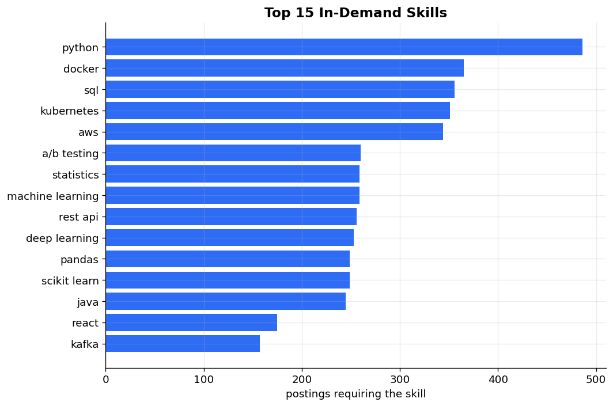
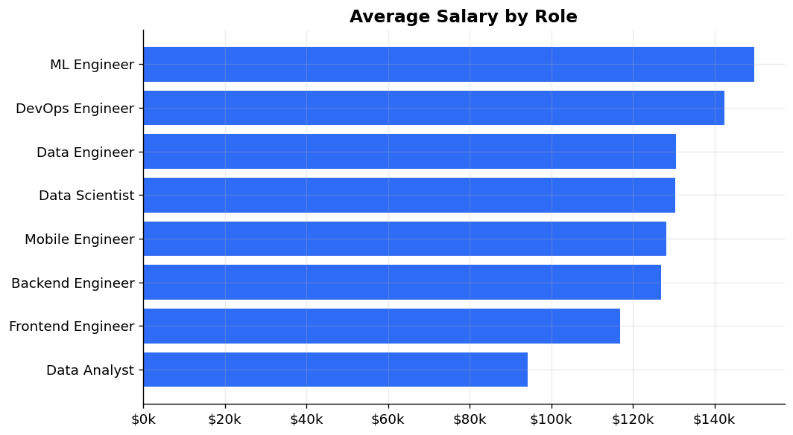
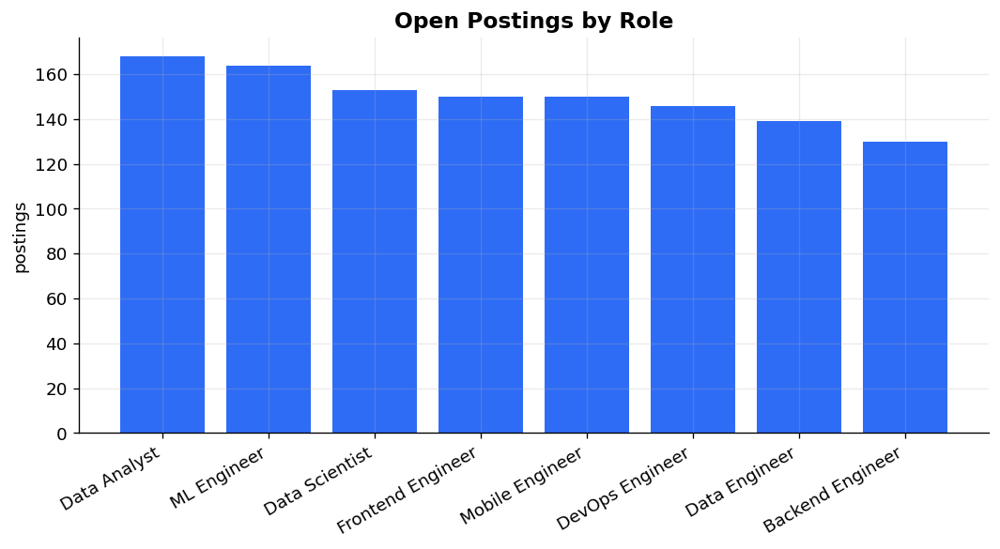
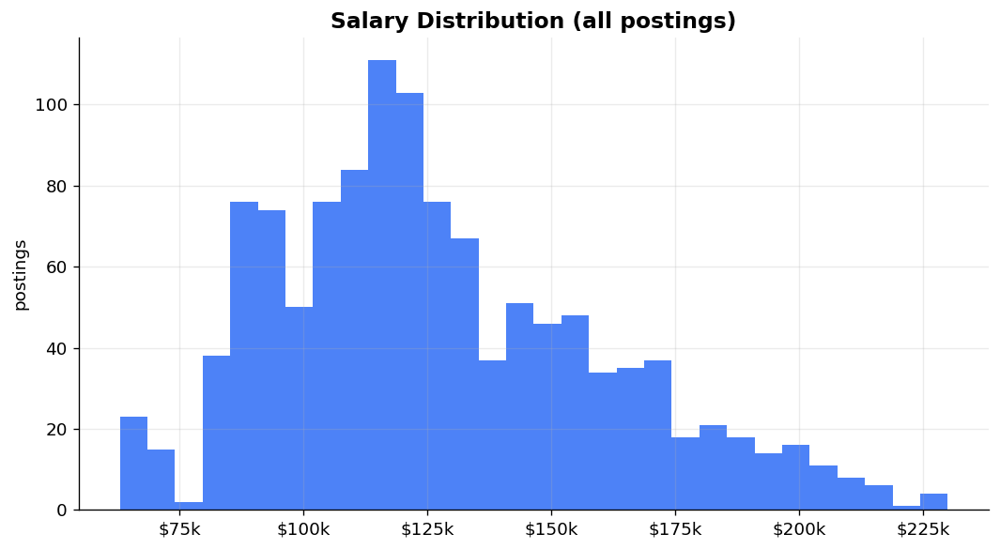
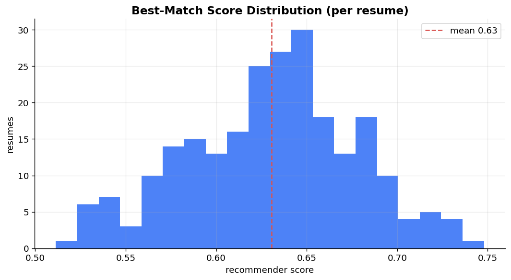

# AI Job Portal &mdash; Recommendation Pipeline

[](https://www.python.org/)
[](https://www.mysql.com/)
[](https://www.mongodb.com/)
[](https://www.docker.com/)
[](https://flask.palletsprojects.com/)
[](LICENSE)
[](tests/)

A job portal with a content-based recommender at its core. Job postings are
cleaned and feature-extracted through a Pandas ETL, then split across **MySQL**
(structured fields) and **MongoDB** (unstructured text + extracted skills). You
paste a resume, the NLP layer parses it, and a **TF-IDF + skill-overlap**
recommender (built on NumPy) ranks the openings. A Flask REST API and a vanilla
JS frontend sit on top, plus Matplotlib dashboards over the warehouse.



For the deep dive &mdash; architecture, every module, the recommender math, the benchmark methodology, and how to run / verify / talk about it &mdash; see [docs/PROJECT_GUIDE.md](docs/PROJECT_GUIDE.md).

## Highlights

- **+31% precision@10** (and **+27% NDCG@10**) over a keyword-overlap baseline, from a [reproducible eval](benchmarks/eval_reco.py) on 240 held-out resumes
- **Hand-rolled TF-IDF in NumPy** &mdash; no scikit-learn; the vectorizer, cosine similarity and skill matcher are all in [src/nlp/](src/nlp/)
- **Dual datastore**: 1,200 postings in a MySQL structured store + ~9.8K extracted job-skill pairs and full text in MongoDB
- **Resume parsing** via a gazetteer-based skill extractor that handles multi-word skills ("apache spark", "machine learning")
- **21 unit tests** across the transform, NLP and recommender layers

## Architecture

```
[data generator]  synthetic, family-tagged postings + resumes
       |
       v
[Pandas ETL]  clean -> normalize salary -> extract skills (NLP)
       |
   +---+--------------------+
   |                        |
[MySQL]                 [MongoDB]
 jobs, job_skills        job_text, resumes
 (structured)            (text + skills)
   |                        |
   +-----------+------------+
               v
   [Recommender]  TF-IDF cosine + skill-overlap (NumPy)
               |
        [Flask REST API]
               |
   +-----------+------------------+
   |                              |
[frontend]                  [Matplotlib]
 resume -> ranked matches    dashboards
```

## Stack

- **Language:** Python 3.10+
- **Data processing:** Pandas, NumPy, Faker
- **NLP / ML:** custom TF-IDF (NumPy), cosine similarity, gazetteer skill extraction
- **Structured store:** MySQL 8.4 (Docker)
- **Document store:** MongoDB 7 (Docker)
- **API:** Flask
- **Frontend:** vanilla HTML / CSS / JS
- **Visualization:** Matplotlib
- **Orchestration:** Docker Compose
- **Testing:** pytest

## Quick start

```bash
# 1. spin up MySQL + MongoDB
docker compose up -d

# 2. python deps
python3 -m venv venv && source venv/bin/activate
pip install -r requirements.txt

# 3. config + MySQL schema
cp .env.example .env
docker exec -i jobs-mysql mysql -uroot -prootpass < sql/schema.sql

# 4. generate data + run the ETL into both stores
python -m src.data_generator
python -m src.pipeline

# 5. the +31% benchmark (no DB needed - runs off data/raw/)
python -m benchmarks.eval_reco

# 6. dashboards
python -m src.analytics.dashboards

# 7. start the API + frontend
python -m src.api.app
# open http://localhost:5002
```

## Project layout

```
.
├── docker-compose.yml          # MySQL 8 + MongoDB 7
├── requirements.txt
├── .env.example
├── sql/schema.sql              # jobs + job_skills (MySQL)
├── data/skills.txt             # skill gazetteer
├── src/
│   ├── config.py
│   ├── data_generator.py       # synthetic, family-tagged postings + resumes
│   ├── pipeline.py             # ETL orchestrator
│   ├── db/ {mysql.py, mongo.py}
│   ├── etl/ {extract.py, transform.py, load.py}
│   ├── nlp/
│   │   ├── preprocess.py        # tokenizer + bundled stopwords (offline)
│   │   ├── skills.py            # gazetteer skill extraction
│   │   └── vectorizer.py        # TF-IDF + cosine (NumPy)
│   ├── reco/
│   │   ├── engine.py            # TF-IDF cosine + skill-overlap scoring
│   │   └── baseline.py          # naive keyword overlap (benchmark control)
│   ├── api/ {app.py, routes.py, service.py}
│   └── analytics/dashboards.py
├── frontend/ {index.html, styles.css, app.js}
├── benchmarks/ {eval_reco.py, results.json}
├── docs/dashboards/             # generated PNGs
└── tests/ {test_transform.py, test_nlp.py, test_reco.py}
```

## How the recommender works

The match score blends two signals:

```
score = 0.6 * cosine(tfidf(resume), tfidf(job)) + 0.4 * jaccard(resume_skills, job_skills)
```

1. **Preprocess** &mdash; lowercase, tokenize, drop a bundled English stopword list. No corpora to download, so it runs offline ([preprocess.py](src/nlp/preprocess.py)).
2. **TF-IDF** &mdash; vocabulary + smoothed IDF fit over all postings, L2-normalized rows so cosine is a dot product ([vectorizer.py](src/nlp/vectorizer.py)).
3. **Skills** &mdash; a gazetteer extractor pulls known skills from the text, matching multi-word phrases before their substrings ([skills.py](src/nlp/skills.py)).
4. **Rank** &mdash; combine the text cosine with the skill Jaccard, return the top N with matched / missing skills per job ([engine.py](src/reco/engine.py)).

## Data stores

**MySQL** holds the structured columns the API filters and aggregates on:

| Table | Grain |
|---|---|
| `jobs` | one row per posting (title, company, family, location, salary, seniority) |
| `job_skills` | one row per (job, skill) pair |

**MongoDB** holds the unstructured side the recommender vectorizes at serve time:

| Collection | Document |
|---|---|
| `job_text` | `{job_id, family, text, skills[]}` |
| `resumes` | `{resume_id, family, text, skills[]}` |

## Benchmark: engine vs. keyword baseline

Ground truth: a posting is relevant to a resume if they share a job family (the
family tags are baked into the synthetic data and never shown to either model).
Each of the 240 resumes is ranked against all 1,200 postings by both the engine
and a naive keyword-overlap baseline (raw term-frequency cosine &mdash; no IDF,
no stopword removal, no skill extraction).

| Metric | Baseline | Engine | Uplift |
|---|---:|---:|---:|
| Precision@10 | 0.748 | 0.981 | **+31.1%** |
| NDCG@10 | 0.771 | 0.982 | **+27.4%** |
| MRR | 0.907 | 0.989 | +9.0% |

Reproduce: `python -m benchmarks.eval_reco` (writes [results.json](benchmarks/results.json)).

The gap comes from the boilerplate every posting and resume shares ("we move
fast", "competitive benefits", "strong communication skills"). A raw keyword
match weights that noise as heavily as real skills; TF-IDF down-weights anything
that appears in most documents, and the skill-overlap term keys on hard
requirements, so the engine separates families the baseline blurs together.

## REST API

Flask on `localhost:5002`, also serving the frontend.

| Endpoint | Description |
|---|---|
| `GET /api/health` | liveness + whether the model is loaded |
| `GET /api/jobs?q=&family=&limit=` | search / list postings |
| `GET /api/jobs/<id>` | posting detail (structured + skills) |
| `POST /api/resume/parse` | resume text in &rarr; extracted skills out |
| `POST /api/recommend` | resume text in &rarr; ranked matches out |
| `GET /api/stats/skills?limit=N` | most in-demand skills |
| `GET /api/stats/salary` | salary stats by role |
| `GET /api/stats/families` | postings per role |
| `POST /api/reload` | rebuild the in-memory model after a pipeline run |

```bash
curl -X POST localhost:5002/api/recommend \
  -H 'Content-Type: application/json' \
  -d '{"text":"python sql apache spark airflow snowflake dbt aws","top_n":5}'
```

## Frontend

A single-page UI ([frontend/](frontend/)): paste or load a sample resume, pick
how many results, and get ranked job cards with a match score and matched /
missing skill chips. A side panel pulls the live skill-demand and salary stats.

## Dashboards

| Chart | Preview |
|---|---|
| Top in-demand skills |  |
| Average salary by role |  |
| Postings per role |  |
| Salary distribution |  |
| Best-match score distribution |  |

## Tests

```bash
python -m pytest tests/ -v
# 21 passed
```

Coverage: salary parsing / enum validation / dedup in transform; tokenizer,
stopwords, multi-word skill extraction and TF-IDF math in NLP; ranking order,
identical-doc similarity and the skill-overlap helper in the recommender.

## Data source

The dataset is **synthetic**, generated with [Faker](https://faker.readthedocs.io/)
in [src/data_generator.py](src/data_generator.py). Postings and resumes are
tagged with a hidden job family so the recommender can be scored against ground
truth, and the family vocabularies overlap on purpose (the data roles all share
Python / SQL) so matching isn't trivial. Synthetic was chosen because real job
boards forbid scraping and rate-limit hard, and because controllable data is
what makes the benchmark reproducible.

## License

MIT &mdash; see [LICENSE](LICENSE).
